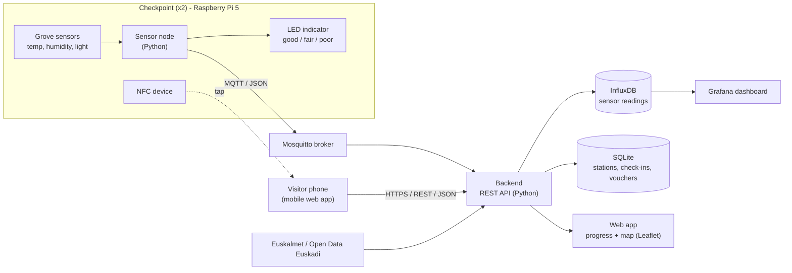

# NatureCheckpoint

**IoT checkpoints that motivate people in Bilbao to spend more time in green spaces.**

Visitors tap their phone on a small checkpoint in a park and collect a digital stamp. Stamps collected during a month unlock a (simulated) reward. At the same time, every checkpoint measures local environmental conditions, rates them as *good / fair / poor for a walk* and shows the result on an LED, so people get useful information on site without staring at their phone.

Final project of the course *End-to-end system solution for the Internet of Things 2026-27*, theme **"IoT for Reconnecting with Nature"**.

| | |
|---|---|
| **Status** | 🚧 Sprint 1 of 3 (3 Nov → 17 Nov 2026), in development |
| **Project board** | [Nature Checkpoint Kanban](https://github.com/users/julianzangl/projects/2) |
| **Documentation** | [Wiki](https://github.com/julianzangl/NatureCheckpoint/wiki) |
| **Proposal** | [IoT Challenge proposal (PDF)](docs/IoT_Challenge_Chahil_Sylkaj_Zangl.pdf) |

> Sections marked **TBD** are planned and will be filled in as the linked issues are completed.

---

## Contents

- [What the system does](#what-the-system-does)
- [MVP scope](#mvp-scope)
- [Architecture](#architecture)
- [Hardware: sensors and actuators](#hardware-sensors-and-actuators)
- [Tech stack](#tech-stack)
- [Repository structure](#repository-structure)
- [Getting started](#getting-started)
- [Interfaces](#interfaces)
- [Privacy](#privacy)
- [Project management](#project-management)
- [Team](#team)

---

## What the system does

The demo park has **two checkpoints**. Each checkpoint consists of a Raspberry Pi 5 with Grove sensors, an LED indicator and an NFC device.

**1. Sensor flow: "Is now a good time for a walk?"**

1. The sensor node reads temperature, humidity and light at a fixed interval.
2. Missing or out-of-range values are discarded.
3. The readings are rated as **good / fair / poor** walk conditions and shown on the LED immediately, without waiting for the cloud. A sensor fault has its own LED state.
4. The readings are published via MQTT, stored in a time-series database and visualised in a dashboard and on a map.

**2. Stamp flow: "Collect stamps, unlock a reward"**

1. A visitor taps their phone at the checkpoint's NFC device.
2. The backend validates the check-in, applies the duplicate rules (max. one stamp per station and day) and stores it.
3. The visitor sees a short confirmation, e.g. *"Stamp 4 of 6 this month"*, and can put the phone away again.
4. With **6 stamps at 2 different stations** in a calendar month, the visitor unlocks a mock voucher.

The visitor only uses a pseudonymous ID. There is no name, no email and no GPS tracking.

## MVP scope

The MVP is done when:

1. A sensor reading changes the local LED state.
2. An NFC tap at a checkpoint creates a check-in that is stored in the backend.
3. Duplicate check-ins are handled according to the documented rules.
4. Monthly progress unlocks a mock reward.
5. The dashboard shows sensor history and check-in counts.
6. A visitor can finish the interaction in seconds and put the phone away.

Not part of the MVP: solar power, outdoor-certified enclosures, LoRaWAN, real partner vouchers, secure NTAG 424 DNA tags and a city-wide deployment. These are described as future work in the [proposal](docs/IoT_Challenge_Chahil_Sylkaj_Zangl.pdf).

## Architecture



The exact check-in flow depends on the NFC hardware, which has not arrived yet ([#9](https://github.com/julianzangl/NatureCheckpoint/issues/9)):

- **Passive NFC tag:** the phone reads a URL and opens the web app, which sends the check-in.
- **NFC reader on the Pi:** the Pi reads the tapped phone or card and sends the check-in itself.

Details: [Wiki → Architecture](https://github.com/julianzangl/NatureCheckpoint/wiki/Architecture).

## Hardware: sensors and actuators

| Component | Type / interface | Role | Status |
|---|---|---|---|
| Raspberry Pi 5 + Grove Base HAT | - | Edge node of each checkpoint | MVP |
| Temperature & humidity sensor | Digital GPIO or I2C (module TBD) | Comfort rating | MVP |
| Light sensor | Analogue (via Grove HAT ADC) | Sun / shade context | MVP |
| LED bar / RGB LED | Digital GPIO | Shows walk conditions and sensor faults | MVP |
| NFC device | TBD (passive tag or reader module) | Check-in | MVP |
| Barometer | I2C | Pressure trend | Planned |
| Sound level sensor | Analogue | Relative noise level, no recording | Planned |
| UV sensor | Analogue | UV indication | Planned |

Wiring and Grove ports: **TBD** ([#4](https://github.com/julianzangl/NatureCheckpoint/issues/4), [#5](https://github.com/julianzangl/NatureCheckpoint/issues/5), [#8](https://github.com/julianzangl/NatureCheckpoint/issues/8)). See [Wiki → Hardware and Wiring](https://github.com/julianzangl/NatureCheckpoint/wiki/Hardware-and-Wiring).

## Tech stack

Planned, to be confirmed in [#2](https://github.com/julianzangl/NatureCheckpoint/issues/2):

| Layer | Technology |
|---|---|
| Sensor node | Python 3, Grove library, `gpiozero`, `paho-mqtt` |
| Messaging | MQTT (Mosquitto, local broker) |
| Backend | Python REST API (FastAPI) with OpenAPI docs |
| Storage | InfluxDB (time series), SQLite (stations, check-ins, vouchers) |
| Dashboards | Grafana |
| Web app | Mobile-first web pages, Leaflet + OpenStreetMap |
| External data | Euskalmet, Open Data Euskadi, Bilbao Open Data (Anillo Verde) |
| Deployment | Docker Compose, systemd services on the Pi |

## Repository structure

Planned layout ([#1](https://github.com/julianzangl/NatureCheckpoint/issues/1)):

```text
NatureCheckpoint/
├── sensor-node/        # Python code running on each Raspberry Pi
│   ├── sensors/        #   one module per sensor
│   ├── actuators/      #   LED control
│   ├── conditions.py   #   good / fair / poor rating
│   └── main.py         #   sampling loop, MQTT publishing
├── backend/            # REST API, MQTT subscriber, database access
├── web/                # visitor web app (check-in, progress, map)
├── deploy/             # docker-compose, systemd units, install scripts
├── docs/               # proposal, assignment, architecture diagrams
├── wiki/               # source of the GitHub wiki pages
├── .env.example        # all configuration keys, without secrets
└── README.md
```

## Getting started

> **TBD.** Commands will be added once the components exist ([#3](https://github.com/julianzangl/NatureCheckpoint/issues/3), [#10](https://github.com/julianzangl/NatureCheckpoint/issues/10), [#11](https://github.com/julianzangl/NatureCheckpoint/issues/11)).

Requirements:

- Raspberry Pi 5 with Raspberry Pi OS, I2C enabled, Grove Base HAT
- Python 3.11+
- Docker and Docker Compose (backend, InfluxDB, Grafana, Mosquitto)

Configuration lives in a `.env` file, created from `.env.example`. **Never commit `.env`.** The repository is public.

Full guide: [Wiki → Setup Guide](https://github.com/julianzangl/NatureCheckpoint/wiki/Setup-Guide).

## Interfaces

**REST API.** JSON over HTTP(S). Once the backend runs, the full OpenAPI specification is served at `/docs`.

| Method | Endpoint | Purpose |
|---|---|---|
| `GET` | `/health` | Service status |
| `GET` | `/api/stations` | Checkpoints with location and current conditions |
| `POST` | `/api/readings` | Store sensor readings (device key required) |
| `POST` | `/api/checkins` | Collect a stamp |
| `GET` | `/api/progress` | Monthly stamps and reward status of the visitor |
| `GET` | `/api/reports/daily` | Daily averages, medians and trends |

**MQTT topics** (planned):

| Topic | Payload |
|---|---|
| `naturecheckpoint/<station_id>/readings` | Sensor readings (JSON) |
| `naturecheckpoint/<station_id>/health` | CPU temperature, load, uptime (JSON) |

Details: [Wiki → Backend and API](https://github.com/julianzangl/NatureCheckpoint/wiki/Backend-and-API).

## Privacy

- Visitors are identified only by a random pseudonymous ID.
- No GPS, no cameras, no audio recording, no advertising profiles.
- Public statistics hide small groups to avoid re-identification.
- The LED and the walk rating give general information, not medical or safety advice.

See [Wiki → Privacy and Ethics](https://github.com/julianzangl/NatureCheckpoint/wiki/Privacy-and-Ethics).

## Project management

We work in Scrum sprints and manage everything on GitHub:

- Backlog, sprint backlog and status are on the [project board](https://github.com/users/julianzangl/projects/2).
- Every item is an issue with a user story and a Definition of Done.
- Work happens on branches. Each pull request is reviewed by a teammate before merging and references its issue, e.g. `Closes #12`.

| Sprint | Dates | Goal |
|---|---|---|
| Sprint 1 | 3 Nov → 17 Nov 2026 | Repo and board set up, architecture defined, sensors and actuators tested |
| Sprint 2 | 17 Nov → 3 Dec 2026 | At least one complete flow from sensor to storage and visualisation |
| Sprint 3 | 3 Dec → 11 Dec 2026 | MVP delivered, release `v1.0` |

## Team

| Name | GitHub |
|---|---|
| Hischam Chahil | [@MA-Hischam](https://github.com/MA-Hischam) |
| Florian Sylkaj | [@fsylkaj](https://github.com/fsylkaj) |
| Julian Zangl | [@julianzangl](https://github.com/julianzangl) |
