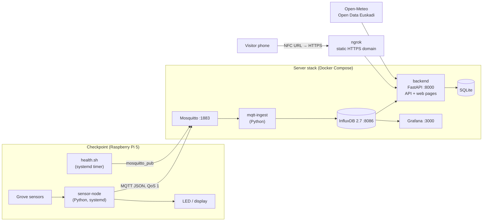

# Architecture and Technical Decisions

These are the technical decisions for the NatureCheckpoint MVP. They are the result of [#2](https://github.com/julianzangl/NatureCheckpoint/issues/2). If the team changes a decision, update this file in the same pull request.

## 1. Overview



- **Development:** every team member runs the server stack on their laptop with `docker compose up`.
- **Demo:** the same stack runs on the Raspberry Pi of checkpoint 1. The demo then does not depend on a laptop or the campus network.
- **Sensor node:** runs natively on each Pi, not in Docker, because it needs direct GPIO and I2C access.

## 2. Decisions

| # | Topic | Decision | Why |
|---|---|---|---|
| D1 | Language | **Python 3.11+** everywhere; the Pi, local dev, Docker image and CI use **3.13** | Matches the labs and the Pi (Raspberry Pi OS on Debian 13 trixie ships Python 3.13) |
| D2 | Backend | **FastAPI + Uvicorn**, Pydantic v2 | Generates the OpenAPI docs the course requires; async; simple |
| D3 | Visitor web app | **Server-rendered pages from FastAPI** (Jinja2 templates + a little vanilla JS + Pico.css). No React, no build step. | The app is used for seconds and must load fast on a phone. One deployment, less tooling. |
| D4 | Map | **Leaflet + OpenStreetMap** tiles, data from `GET /api/stations` | Free, no key, fits the course theme |
| D5 | Telemetry | **MQTT** via **Mosquitto 2** (Docker), **paho-mqtt 2.x**, QoS 1, no retained messages | Second protocol besides REST. Decouples the Pi from the backend. Campus blocks outbound MQTT, so the broker runs locally. |
| D6 | MQTT security | `allow_anonymous false`; one Mosquitto user per checkpoint plus one for `mqtt-ingest` (password file, not committed) | Device authentication without our own key logic |
| D7 | Readings path | Readings go **only via MQTT**. There is no `POST /api/readings`. | One path is easier to build and to test |
| D8 | Ingest | A small Python service **`mqtt-ingest`** (same image as the backend, different command) subscribes and writes to InfluxDB | Our own code, testable. Keeps the API process simple. |
| D9 | Time series | **InfluxDB 2.7** (Docker), `influxdb-client` for Python, org `naturecheckpoint`, bucket `environment`, retention 90 days | Used in the final lab, works well with Grafana |
| D10 | Relational data | **SQLite** via **SQLModel** for stations, visitors, check-ins and vouchers | No extra server; SQL constraints enforce the duplicate rule |
| D11 | Dashboards | **Grafana**. The data source and dashboards are **provisioned from files** in `deploy/grafana/`. | Reproducible: `docker compose up` shows the dashboards without clicking |
| D12 | Visitor identity | Random **UUID4** in an `HttpOnly`, `SameSite=Lax` cookie (`nc_visitor`, valid 1 year). No login. | Pseudonymous, zero friction |
| D13 | Time | Store all timestamps in **UTC**. "Day" and "month" for the stamp rules are computed in **Europe/Madrid**. | Avoids rules breaking around midnight |
| D14 | NFC | **Reader flow:** each checkpoint has an NFC reader on the Pi (M5Stack Unit RFID 2, I2C). A visitor taps any 13.56 MHz card (campus card, key fob, NTAG sticker). The Pi hashes the UID with a secret salt (`CARD_SALT`) and calls `POST /api/checkins/card` with a device token (`DEVICE_TOKEN`). The card hash is the visitor's pseudonym; the LCD shows the stamp count and the voucher code. The phone flow (`/c/<station_id>` page, cookie) stays available for NFC stickers. | The delivered devices are readers, not tags ([#9](https://github.com/julianzangl/NatureCheckpoint/issues/9)). Readers cannot open a URL on a phone and iPhones cannot be read like a card, so cards are the reliable path. Only the salted hash leaves the Pi. |
| D15 | Public URL | **ngrok** with the free **static domain** forwards to backend `:8000`. This URL is written to the NFC tags. Fallback: phone hotspot plus the Pi's IP. | Phones on eduroam usually cannot reach a Pi. A static domain keeps the NFC tags valid. |
| D16 | External data | **Open-Meteo** for weather and UV forecast (no key) and the **Open Data Euskadi air-quality API** (no key) | Free, no registration. Euskalmet needs a key and JWT signing; optional later. |
| D17 | Config | Secrets and hosts go in **`.env`**, thresholds in **`config.toml`** (read with `tomllib`) | `.env` stays out of git; thresholds are versioned |
| D18 | Sensor node runtime | `systemd` services for `sensor-node`, backend and ingest; `systemd` timer for `health.sh` (bash + `mosquitto_pub`). Units and installer in `deploy/pi/`. | The course requires systemd/crontab and shell scripts |
| D19 | GPIO | **gpiozero** (uses `lgpio` on the Pi 5) for digital pins. Grove HAT ADC via **grove.py** (I2C). Never `RPi.GPIO`. | `RPi.GPIO` does not work on the Pi 5 |
| D20 | Quality | **ruff** (lint + format) and **pytest**. GitHub Actions runs both on every pull request. | Cheap, keeps the code consistent |
| D21 | Dependencies | One pinned `requirements.txt` per component, plus `sensor-node/requirements-pi.txt` (adds grove.py, Pi only) and a root `requirements-dev.txt` (ruff, pytest). Tool config lives in the root `pyproject.toml`. The Pi venv is created with `--system-site-packages` so the apt packages `python3-lgpio` and `python3-gpiozero` work. | Avoids building `lgpio` from source |
| D22 | Demo deployment | The demo Pi already runs Mosquitto, InfluxDB 2 and Grafana as system services (course labs) and has no Docker. There, backend and ingest run natively from the project venv (`deploy/pi/*.service`), and `deploy/pi/provision_native.py` creates our org, bucket, token, data source and dashboards. On other machines Docker Compose (`deploy/`) provides the same stack. One Pi hosts both demo checkpoints: it publishes its readings for `station-1` and `station-2` and has one reader per station. | Works with the hardware we have without changing the lab setup. Same contracts in both setups. |

## 3. Repository layout

```text
NatureCheckpoint/
├── sensor-node/
│   ├── nc_sensor/
│   │   ├── sensors/          # temp_humidity.py, light.py, ...
│   │   ├── actuators/        # led.py
│   │   ├── conditions.py     # good / fair / poor (pure function)
│   │   ├── publisher.py      # MQTT
│   │   └── main.py           # sampling loop
│   ├── tests/
│   ├── config.toml
│   ├── requirements.txt      # portable deps (CI)
│   └── requirements-pi.txt   # + grove.py, Pi only
├── backend/
│   ├── app/
│   │   ├── main.py           # FastAPI app, routers, /health
│   │   ├── routers/          # stations.py, checkins.py, progress.py, reports.py
│   │   ├── models.py         # SQLModel tables
│   │   ├── services/         # rules.py (stamps, rewards), influx.py, external.py
│   │   ├── templates/        # Jinja2 pages (check-in, progress, map, privacy)
│   │   └── static/
│   ├── ingest/
│   │   └── main.py           # MQTT → InfluxDB
│   ├── tests/
│   ├── Dockerfile
│   └── requirements.txt
├── deploy/
│   ├── docker-compose.yml
│   ├── mosquitto/            # mosquitto.conf (passwd is git-ignored)
│   ├── grafana/provisioning/ # datasources/, dashboards/
│   ├── stations.json         # seed data for both checkpoints
│   └── pi/                   # systemd units, health.sh, install.sh
├── docs/
├── wiki/
├── tools/                    # dev helpers, e.g. fake_station.py
├── .github/                  # workflows/ci.yml, pull_request_template.md
├── pyproject.toml            # ruff + pytest config
├── requirements-dev.txt
├── CONTRIBUTING.md
├── .env.example
└── README.md
```

## 4. Interface contracts

Agree on these first. Then everyone can work in parallel with test data.

### MQTT

| Topic | Publisher | QoS |
|---|---|---|
| `naturecheckpoint/<station_id>/readings` | sensor-node, every `SAMPLE_INTERVAL_S` (default 10 s) | 1 |
| `naturecheckpoint/<station_id>/health` | `health.sh`, every 60 s | 1 |

`readings` payload. A sensor that failed is sent as `null`:

```json
{
  "station_id": "station-1",
  "timestamp": "2026-11-19T10:00:00Z",
  "temperature": 17.4,
  "humidity": 62.0,
  "light": 540,
  "condition": "good",
  "condition_reason": "all values in comfort range"
}
```

`health` payload:

```json
{ "station_id": "station-1", "timestamp": "2026-11-19T10:00:00Z", "cpu_temp": 52.1, "load1": 0.31, "uptime_s": 3600 }
```

### InfluxDB

| Measurement | Tags | Fields |
|---|---|---|
| `environment` | `station_id` | `temperature`, `humidity`, `light` (float), `condition` (string) |
| `device_health` | `station_id` | `cpu_temp`, `load1`, `uptime_s` |
| `checkins` | `station_id` | `taps` (1 per tap), `stamps` (1 if it was a stamp, else 0). Written by the backend; no visitor ID. |

### REST API (JSON)

| Method | Path | Response (short) |
|---|---|---|
| `GET` | `/health` | `{ "status": "ok" }` |
| `GET` | `/api/stations` | `[ { station_id, name, lat, lon, description, latest: { temperature, humidity, light, condition, timestamp } \| null } ]` |
| `POST` | `/api/checkins` | body `{ station_id, tag_payload? }` → `{ status: "stamped" \| "already_stamped", station, stamps_this_month, goal, reward: { code, month } \| null }` |
| `POST` | `/api/checkins/card` | header `Authorization: Bearer <DEVICE_TOKEN>`, body `{ station_id, card_hash }` → same response as `/api/checkins`. `401` for a wrong device token. |
| `GET` | `/api/progress` | `{ month, stamps, goal, stations_visited, stations_missing, reward_status, voucher_code? }` |
| `GET` | `/api/weather` | `{ temperature, humidity, uv_index, weather_code, description, time, source }` (Open-Meteo, cached 10 min; `503` if unavailable) |
| `GET` | `/api/reports/daily?station_id=&date=` | `{ station_id, date, samples, temperature: { avg, median, min, max, trend } \| null, humidity, light, conditions: { good: n, ... } }` |

Web pages (HTML, same app):

| Path | Page |
|---|---|
| `/c/<station_id>` | Check-in page (opened by NFC). Sends `POST /api/checkins`. |
| `/progress` | Monthly progress |
| `/map` | Map of the checkpoints |
| `/privacy` | Privacy notice |

Phone visitors are identified by the `nc_visitor` cookie, not by a field in the request body. Card visitors are identified by `card_hash` (salted SHA-256 of the card UID, made on the Pi).

### Stamp and reward rules

- A check-in is **qualifying** if it is the visitor's first one at that station on that day (Europe/Madrid). This is enforced by a unique index on `(visitor_id, station_id, local_date)` for qualifying check-ins.
- **Reward:** 6 qualifying stamps in a calendar month at at least 2 different stations. Then the visitor gets one voucher per month, with code `NC-` plus 8 random characters (`secrets`).
- **Rate limit:** max. 10 check-in requests per visitor per minute.

### Walk-condition thresholds

Initial values, stored in `sensor-node/config.toml`:

| Level | Temperature °C | Humidity % |
|---|---|---|
| good | 15–25 | 30–70 |
| fair | 8–15 or 25–30 | 20–30 or 70–85 |
| poor | < 8 or > 30 | < 20 or > 85 |

The worst level wins. A missing value is ignored. If all values are missing, the result is `fault`.

## 5. Ports and configuration

| Service | Port |
|---|---|
| backend | 8000 |
| InfluxDB | 8086 |
| Grafana | 3000 |
| Mosquitto | 1883 |

`.env` keys:

| Key | Purpose |
|---|---|
| `STATION_ID` | ID of the checkpoint |
| `SAMPLE_INTERVAL_S` | Seconds between samples |
| `MQTT_HOST`, `MQTT_PORT` | Broker address |
| `MQTT_USERNAME`, `MQTT_PASSWORD` | Broker login of the checkpoint |
| `INGEST_MQTT_USERNAME`, `INGEST_MQTT_PASSWORD` | Broker login of `mqtt-ingest` |
| `INFLUXDB_URL`, `INFLUXDB_TOKEN`, `INFLUXDB_ORG`, `INFLUXDB_BUCKET` | Time-series database |
| `INFLUXDB_ADMIN_PASSWORD` | InfluxDB web UI login (initial setup) |
| `DATABASE_PATH` | SQLite file |
| `PUBLIC_BASE_URL` | Public HTTPS URL written to the NFC tags |
| `NGROK_AUTHTOKEN` | ngrok login |
| `GRAFANA_ADMIN_PASSWORD` | Grafana admin login |
| `STATION_IDS` | Further station IDs this Pi publishes readings for (comma separated, demo) |
| `BACKEND_URL` | Backend address for card check-ins from the Pi |
| `DEVICE_TOKEN` | Shared secret of the checkpoints for `POST /api/checkins/card` |
| `CARD_SALT` | Secret salt for hashing card UIDs on the Pi |
| `REWARD_STAMPS`, `REWARD_MIN_STATIONS` | Reward rule (default 6 stamps at 2 stations) |
| `CHECKIN_RATE_LIMIT`, `CHECKIN_RATE_WINDOW_S` | Check-in rate limit per visitor |

## 6. Hardware defaults

Use the modules of the lab kit. Default ports, change them if the kit differs and update [Hardware and Wiring](../wiki/Hardware-and-Wiring.md):

| Component | Grove port | Library |
|---|---|---|
| Temperature & humidity (Grove DHT11 digital; fallback DHT20 I2C) | D18 (GPIO18), or I2C | Same driver as in the labs. If the DHT driver fails on the Pi 5, switch to a DHT20 (I2C). |
| Light sensor | A2 | grove.py ADC |
| Status LED: Grove Red LED Button (LED on GPIO16, button on GPIO17 unused) | D16 | gpiozero (`[led] type = "single"`) |
| LCD 16x2 (Grove, white on blue, address `0x3E`, no RGB backlight) | I2C (bus 1) | grove.py. Text = rating and values. |
| NFC reader 1 (M5Stack Unit RFID 2, WS1850S, address `0x28`) | I2C (bus 1) | RC522-compatible register set over I2C |
| NFC reader 2 (same model, same fixed address) | D22 as software I2C (bus 3) | Same as reader 1, opened on `/dev/i2c-3` |

Both NFC readers have the fixed address `0x28`, and all `I2C` ports of the Grove HAT are the same bus, so reader 2 runs on a second bus. `/boot/firmware/config.txt` on the Pi contains `dtoverlay=i2c-gpio,bus=3,i2c_gpio_sda=23,i2c_gpio_scl=22`. On Grove ports the first pin (yellow) is SCL, so on D22 GPIO22 is SCL and GPIO23 is SDA. Details and checks: [Hardware and Wiring](../wiki/Hardware-and-Wiring.md#nfc-readers).
