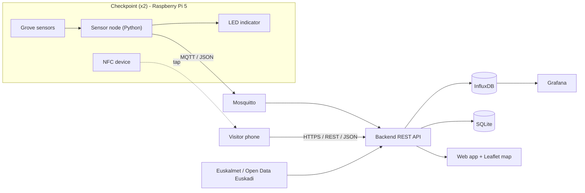
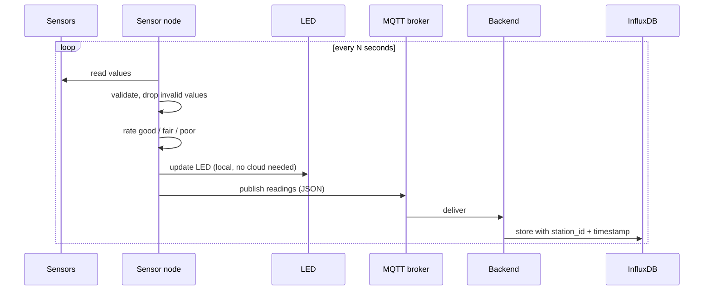
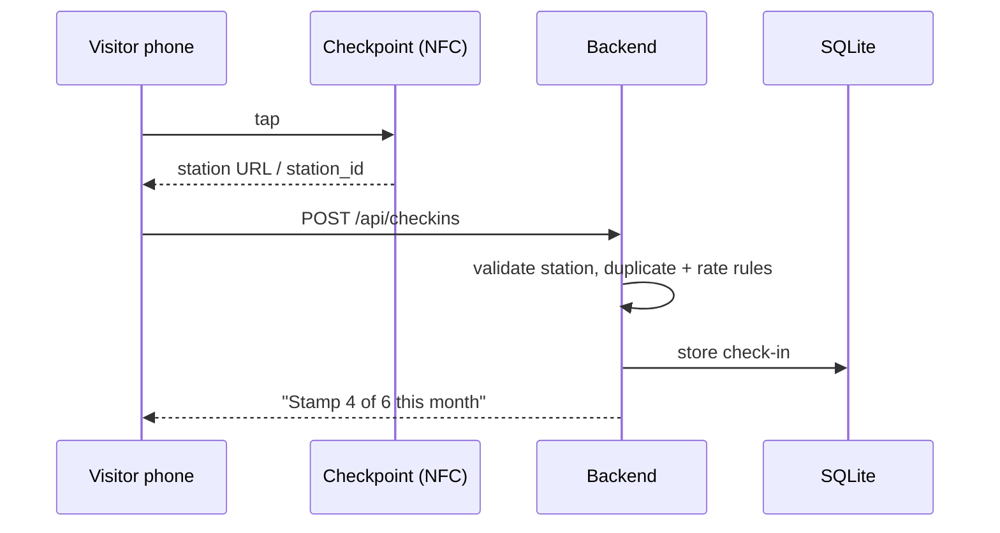
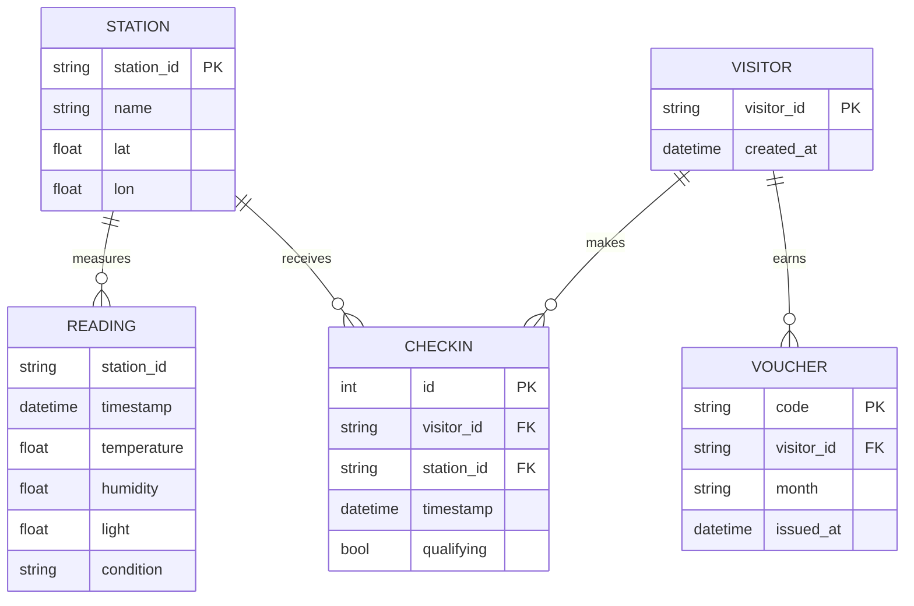

# Architecture

> Planned design, to be confirmed in [#2](https://github.com/julianzangl/NatureCheckpoint/issues/2).

## Overview

The system has three parts:

1. **Sensor node.** Python on a Raspberry Pi 5 at each checkpoint. It reads sensors, rates walk conditions, drives the LED and publishes readings.
2. **Backend.** Python REST API plus MQTT subscriber. It stores data, validates check-ins, applies reward rules and fetches external data.
3. **Frontend.** Mobile web app for visitors (check-in, progress, map) and Grafana dashboards for operators.

## Data flows

### Sensor flow

The LED reacts locally, so the checkpoint still gives feedback when the network is down. Readings are buffered locally while the broker is unreachable ([#12](https://github.com/julianzangl/NatureCheckpoint/issues/12)).

### Stamp flow

**Open point:** the NFC hardware has not arrived yet ([#9](https://github.com/julianzangl/NatureCheckpoint/issues/9)).

- **Passive NFC tag:** the flow above applies. The phone opens the web app, which sends the check-in.
- **NFC reader module on the Pi:** the Pi reads the tapped phone or card and sends the check-in to the backend itself.

**Known limitation:** a passive tag cannot tell the checkpoint that a stamp happened, so the confirmation is shown on the phone only.

## Communication

| Link | Technology | Format |
|---|---|---|
| Phone ↔ checkpoint | NFC (ISO 14443 / NDEF) | URL or UID |
| Sensor node → backend | MQTT (local Mosquitto broker) | JSON |
| Phone / web app ↔ backend | REST over HTTP(S) | JSON |
| Backend → external APIs | REST over HTTPS | JSON |

MQTT runs on a **local broker** (Pi or laptop), because outbound MQTT ports are closed on the campus network.

## Data model

- `READING` lives in **InfluxDB**: `station_id` is a tag, sensor values are fields.
- All other entities live in **SQLite**.

## Design decisions

| Decision | Reason |
|---|---|
| MQTT for telemetry | Lightweight publish/subscribe, decouples the sensor node from the backend, adds a second protocol besides REST |
| REST + JSON for the app | Simple for the browser, documented with OpenAPI |
| InfluxDB + Grafana | Built for time series; covered in the course labs |
| SQLite for check-ins | Relational rules (duplicates, monthly counts) without running another server |
| LED logic on the edge | Feedback works without network |
| Pseudonymous ID instead of login | Minimal personal data, fast check-in |
