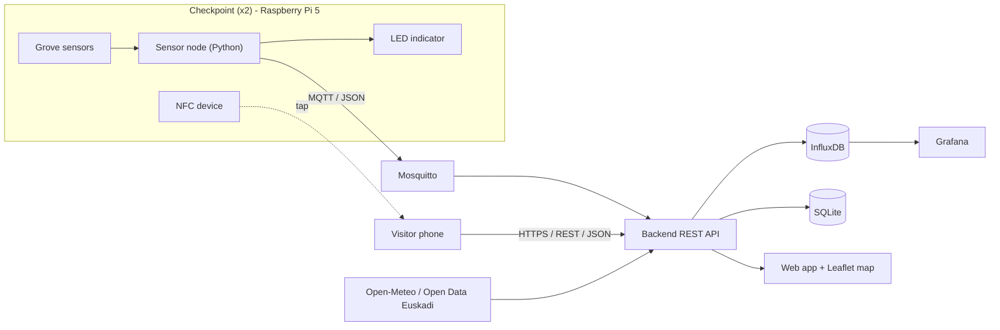
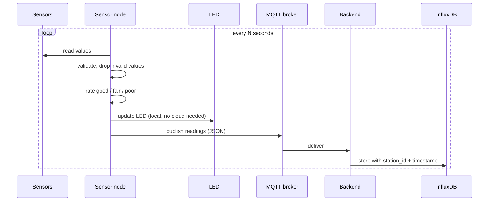
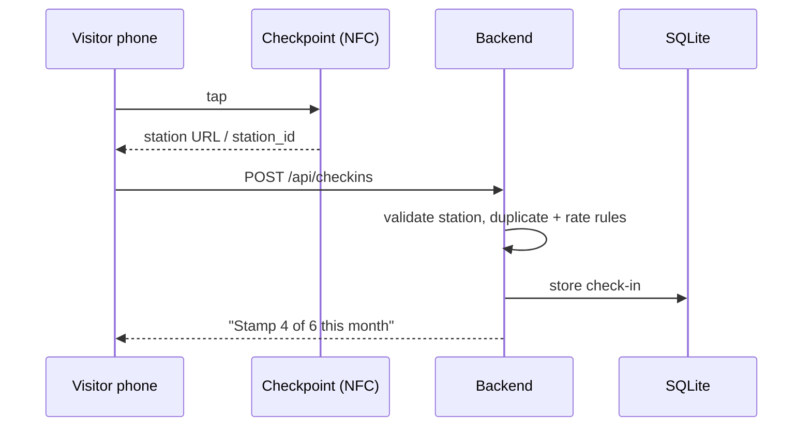
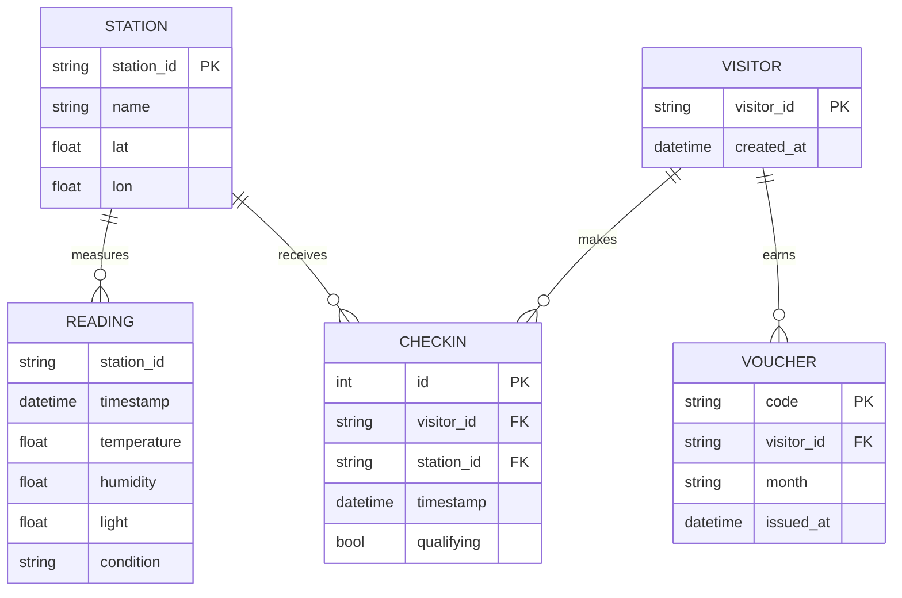

# Architecture

> The full list of technical decisions and the exact interface contracts (MQTT payloads, InfluxDB schema, REST responses) are in [docs/architecture.md](https://github.com/julianzangl/NatureCheckpoint/blob/main/docs/architecture.md). This page gives the overview.

## Overview

The system has three parts:

1. **Sensor node.** Python on a Raspberry Pi 5 at each checkpoint. It reads sensors, rates walk conditions, drives the LED and publishes readings.
2. **Backend.** Python REST API plus MQTT subscriber. It stores data, validates check-ins, applies reward rules and fetches external data.
3. **Frontend.** Mobile web app for visitors (check-in, progress, map) and Grafana dashboards for operators.

**Where things run:**

- **Server stack** (Mosquitto, `mqtt-ingest`, backend, InfluxDB, Grafana): Docker Compose. It runs on the laptops during development and on the Raspberry Pi of checkpoint 1 for the demo.
- **Sensor node:** runs natively on each Pi as a `systemd` service.
- **Public access:** phones reach the backend through an ngrok static HTTPS domain.

## Data flows

### Sensor flow

The LED reacts locally, so the checkpoint still gives feedback when the network is down. Readings are buffered locally while the broker is unreachable ([#12](https://github.com/julianzangl/NatureCheckpoint/issues/12)).

### Stamp flow

**Open point:** the NFC hardware has not arrived yet ([#9](https://github.com/julianzangl/NatureCheckpoint/issues/9)).

- **Passive NFC tag:** the flow above applies. The phone opens the web app, which sends the check-in.
- **NFC reader module on the Pi:** the Pi reads the tapped phone or card and sends the check-in to the backend itself.

**Known limitation:** a passive tag cannot tell the checkpoint that a stamp happened, so the confirmation is shown on the phone only.

## Communication

| Link | Technology | Format |
|---|---|---|
| Phone ↔ checkpoint | NFC (ISO 14443 / NDEF) | URL or UID |
| Sensor node → backend | MQTT (local Mosquitto broker) | JSON |
| Phone / web app ↔ backend | REST over HTTP(S) | JSON |
| Backend → external APIs | REST over HTTPS | JSON |

MQTT runs on a **local broker** (Pi or laptop), because outbound MQTT ports are closed on the campus network.

## Data model

- `READING` lives in **InfluxDB**: `station_id` is a tag, sensor values are fields.
- All other entities live in **SQLite**.

## Key design decisions

The full list (D1–D21) is in [docs/architecture.md](https://github.com/julianzangl/NatureCheckpoint/blob/main/docs/architecture.md#2-decisions).

| Decision | Reason |
|---|---|
| MQTT only for sensor data, REST only for the app | Each protocol has one clear job. Two protocols for the course requirements. |
| FastAPI serves the API **and** the web pages | One deployment, OpenAPI docs for free, no frontend build step |
| InfluxDB + Grafana, provisioned from files | Built for time series; reproducible dashboards |
| SQLite for check-ins | The duplicate rule is a unique index. No extra server. |
| LED logic on the edge | Feedback works without network |
| Pseudonymous cookie ID instead of login | Minimal personal data, check-in in seconds |
| ngrok static domain | Phones can reach the backend from any network; NFC tag URLs stay valid |
